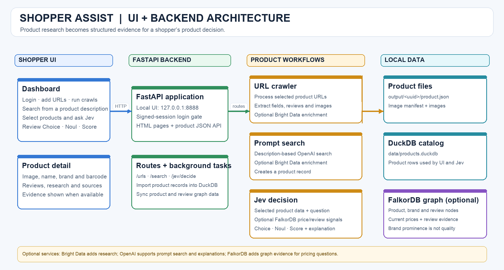
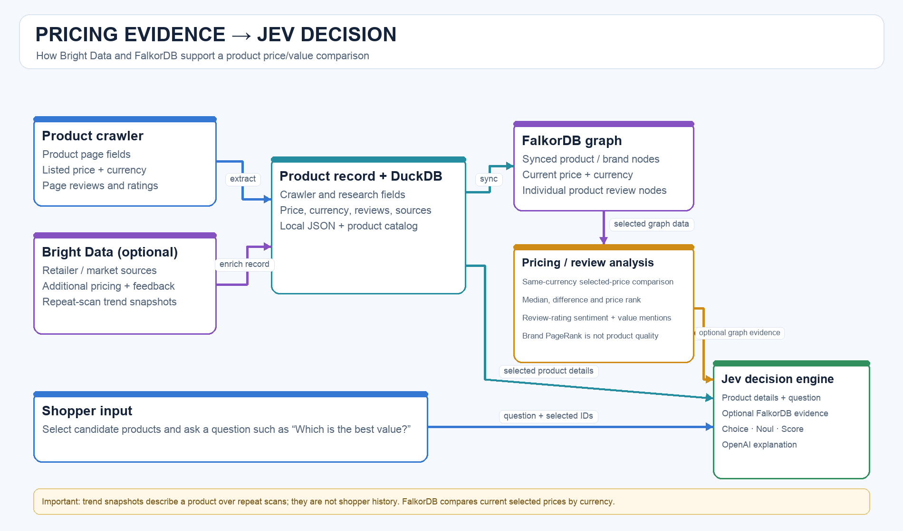

# Shopper Assist

Shopper Assist helps people make a more informed choice when they are unsure
which product to buy. It collects product details and shopper feedback, adds
optional Bright Data web research, and lets the Jev decision engine compare
products against a shopper's question. Optional FalkorDB analysis contributes
price comparisons and review signals to pricing decisions.

The URL crawler reads specific product URLs; it does not recursively crawl
retailer sites or discover related products. Bright Data enrichment is an
optional, separate web-research step. The crawler may also request
same-product resources to complete the record:

- Shopify `product.js` when the URL path is `/products/{handle}`
- the PowerReviews request named by the widget on that same page, when reviews are not in the HTML

Video is not downloaded. Still images are limited to jpg, png, webp, and avif gallery and variant images.

## How it works

```mermaid
flowchart LR
    shopper["Shopper<br/>question + product options"] --> ui["Web UI<br/>127.0.0.1:8888"]
    ui --> crawler["Product crawler<br/>specific product URLs"]
    crawler --> productpages["Retail product pages<br/>details + reviews"]
    productpages --> records["Product records<br/>fields + images"]
    records --> duckdb["DuckDB<br/>local product store"]
    crawler -. optional research .-> brightdata["Bright Data<br/>product sources + snapshots"]
    brightdata --> records
    ui -->|selected products + question| jev["Jev decision engine"]
    duckdb -->|product details| jev
    graph["FalkorDB graph<br/>products + brands + reviews"] -. optional price/review evidence .-> jev
    jev -->|Choice + Noul + Score| shopper

    classDef shopper fill:#dbeafe,stroke:#2563eb,color:#172554,stroke-width:2px;
    classDef app fill:#dcfce7,stroke:#16a34a,color:#14532d,stroke-width:2px;
    classDef data fill:#fef3c7,stroke:#d97706,color:#78350f,stroke-width:2px;
    classDef service fill:#f3e8ff,stroke:#9333ea,color:#581c87,stroke-width:2px;
    class shopper,ui app;
    class crawler,jev app;
    class productpages,records,duckdb data;
    class brightdata,graph service;
```

## Architecture

The diagrams below show the application components and the pricing evidence
flow into Jev.





## Main components

- **Product crawler:** processes product URLs from `urls.txt`, extracts available
  product fields and reviews, downloads still images, and writes a product
  record.
- **Bright Data enrichment (optional):** searches for additional product
  evidence, such as ranking, reviews, manuals, pricing, retailer sources, and
  market trends. Trend history grows when a product is scanned again.
- **Local product store:** saves product documents and images under
  `output/<uuid>/` and indexes records in `data/products.duckdb`.
- **FalkorDB graph (optional):** stores product, brand, and review relationships.
  For selected products, its current pricing analysis compares prices only
  within the same currency, summarizes review-rating sentiment and price/value
  comment mentions, and provides brand graph prominence. Brand prominence is
  not a product-quality score.
- **Jev decision engine:** takes the selected products and the shopper's
  question and returns a Choice, Noul, and Score. When enabled, it can use
  FalkorDB price and review evidence for pricing or value questions.
- **Web UI and API:** provides the local dashboard, product detail pages, and
  product API on port `8888`.

The current implementation uses product information and the shopper's question;
it does **not** yet model a shopper's historical purchase or browsing patterns.
It also does not claim to independently verify product quality. Those are
possible future personalization and evidence improvements, not current
FalkorDB/Jev capabilities.

## Quick start

```bash
python3 -m venv .venv
source .venv/bin/activate
python3 -m pip install -e .
python3 -m product_crawler.server
```

Open [http://127.0.0.1:8888](http://127.0.0.1:8888) and sign in using a local
configured account. Optional OpenAI, OpenRouter, Bright Data, and FalkorDB
features need their corresponding credentials and service configuration.
Keep credentials in local configuration files; never commit API keys or
passwords.

For fuller setup steps, see [Getting started](documentation/GETTING_STARTED.md).
For screen-level behavior, see the [UI overview](documentation/UI_OVERVIEW.md).

## Run

```bash
python3 -m venv .venv
source .venv/bin/activate
python3 -m pip install -e .
python3 -m product_crawler urls.txt
```

After install, the `product-crawler` command is the same entry point.

The command takes one URL file. If you omit it, or the file is missing, the tool prints an error and exits with status `2` without fetching anything.

`urls.txt` is one absolute `http` or `https` URL per line. A line that already ends with a UUID folder name is skipped. After a successful crawl, that UUID is written on the same line:

```text
https://www.sportsbasement.com/products/clifton-16?variant=41172026130504 23d0c747-1512-4212-9bf3-b61636fc83e7
https://example.com/products/next-shoe
```

A `.json` file is the same list as objects. Pending URLs use `"folder": null`. Finished ones store the UUID folder name:

```json
[
  {
    "url": "https://www.sportsbasement.com/products/clifton-16?variant=41172026130504",
    "folder": "23d0c747-1512-4212-9bf3-b61636fc83e7"
  }
]
```

The `variant` query parameter selects which variant is recorded. Prices from Shopify `product.js` are converted from cents. A failed URL stays without a folder name so a later run can try it again.

## Output

Each run creates `output/<uuid>/`:

```text
output/<uuid>/
  product.json           product fields from the page and same-product endpoints
  image-manifest.json    local image filenames mapped to source URLs
  images/                gallery and variant stills
```

`product.json` includes the title, brand, selected variant, price, currency, availability, SKU, description, dimensions, specs, materials, weight, ranking, popularity, star rating, review count, breadcrumbs, and options when those fields are present. `reviews` holds the 10 latest user feedbacks from whatever section that page uses: a review feed named on the page, structured review data, or visible review, feedback, or comment blocks. Each comment is stored at up to 100 words. When none are found, `reviews` is an empty list and `reviews_note` is `No user feedback found on this page.` Missing fields are JSON `null`.

## Pages

After a crawl, the product JSON is stored as one DuckDB row. The local server reads that table.

```bash
python3 -m product_crawler.server
```

Open http://127.0.0.1:8888/<uuid>. The page shows one product image, the product name, the brand in uppercase, and the market barcode (UPC-A, EAN-13, GTIN-14, or EAN-8 when the stored code matches that length). The sample page is http://127.0.0.1:8888/23d0c747-1512-4212-9bf3-b61636fc83e7 and its brand is HOKA.

The same UUID is the API record:

- `GET /api/products` lists rows
- `GET /api/products/<uuid>` returns the row, including the full scraped document
- `POST /api/products` stores a new document or imports `output/<uuid>`
- `PUT /api/products/<uuid>` updates the name, brand, and barcode
- `DELETE /api/products/<uuid>` removes the row

The database file is `data/products.duckdb`.

## Tests

```bash
python3 -m unittest discover -s tests -v
```

## Documentation

- [Documentation index](documentation/README.md)
- [Getting started](documentation/GETTING_STARTED.md)
- [UI overview](documentation/UI_OVERVIEW.md)
