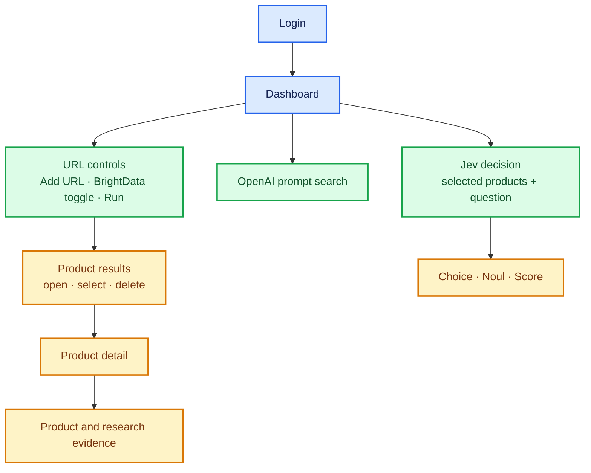

# UI overview

The local application at `http://127.0.0.1:8888` has an authenticated product
dashboard and a detail page for each stored product. It is served by the
FastAPI application in `product_crawler.server`.

## Dashboard features

- **Session login:** the dashboard and product pages require a configured
  account. Use **Log out** to end the browser session.
- **URL crawling:** add product URLs to the local URL list, optionally request
  BrightData enrichment, and run pending crawls. Status messages report progress
  and errors.
- **Product results:** open each product detail page from its result link.
  Result labels distinguish base-crawler, BrightData-enriched, and OpenAI-prompt
  products.
- **Selection and deletion:** select products for a Jev decision or delete
  selected products and their local files.
- **Prompt search:** search for a product from a text description using the
  OpenAI API without running the built-in URL crawler.
- **Decision engine:** ask Jev a question about selected products to get a
  Choice, Noul, and Score. Optional FalkorDB analysis adds price and review
  evidence for pricing questions. Price comparisons are scoped to the selected
  products that share a currency; review sentiment is derived from available
  ratings and price/value comment keyword matches.
- **Reset:** clears the current dashboard inputs, selections, decision, and
  message; it does not remove saved data.

## Product detail page

A product page presents the available product image, name, brand, barcode and
source URL. Depending on the stored product data, it can also show:

- A note and fetched URL when a page was blocked and an alternate source was
  used.
- User feedback and product videos.
- BrightData results grouped into ranking evidence, feedback, manuals and
  instructions, pricing and availability, product identity and specifications,
  retailer sources, and product market trends.
- OpenAI research answers and their sources.

Sections with no corresponding product data may be absent. Barcode formats are
identified when the stored code length matches UPC-A, EAN-13, GTIN-14, or EAN-8.

## Decision data and current limits

Jev receives the selected products' stored details and the shopper's question.
When FalkorDB analysis is enabled, it can additionally receive same-currency
prices, review-rating signals, price/value comment mentions, and brand graph
context. Brand PageRank represents graph prominence, not product quality.

The application does not currently model an individual shopper's historical
purchases or browsing pattern. BrightData trend observations track product
snapshots collected over repeat scans; they are not a shopper's personal
history. Product quality and delivery-time decisions depend on available
product evidence and the question and are not independently verified by a
dedicated quality or delivery model.

## High-level application flow

The diagram uses Mermaid class styles for colored blocks and arrows. A Mermaid
renderer (for example, GitHub or a compatible Markdown preview extension) is
needed to display it as a graphic.

```mermaid
flowchart LR
    browser["Browser<br/>login + dashboard"] -->|HTTP on localhost:8888| app["FastAPI<br/>routes + UI"]
    app -->|pending URLs| crawler["URL crawler"]
    crawler -->|product fields + images| files["output/&lt;uuid&gt;/<br/>product.json + images"]
    files -->|import / update| db["DuckDB<br/>products"]
    db -->|results + product details| app
    app -->|description search| openai["OpenAI API<br/>prompt search"]
    openai -->|product record| files
    crawler -. optional enrichment .-> brightdata["BrightData<br/>research + trends"]
    brightdata -->|enriched record| files
    app -->|selected products + question| jev["Jev decision engine"]
    jev -->|Choice, Noul, Score| browser
    jev -. optional pricing evidence .-> graph["FalkorDB<br/>product graph"]
    graph --> jev

    classDef ui fill:#dbeafe,stroke:#2563eb,color:#172554,stroke-width:2px;
    classDef service fill:#dcfce7,stroke:#16a34a,color:#14532d,stroke-width:2px;
    classDef storage fill:#fef3c7,stroke:#d97706,color:#78350f,stroke-width:2px;
    classDef integration fill:#f3e8ff,stroke:#9333ea,color:#581c87,stroke-width:2px;
    class browser,app ui;
    class crawler,jev service;
    class files,db storage;
    class openai,brightdata,graph integration;
```

## Dashboard layout



## API

The same server exposes a product API for clients using the logged-in session:

- `GET /api/products` lists stored products.
- `GET /api/products/{uuid}` returns a product record.
- `POST /api/products` creates a product or imports an output folder.
- `PUT /api/products/{uuid}` updates its name, brand, or barcode.
- `DELETE /api/products/{uuid}` removes the product and its local output files.
